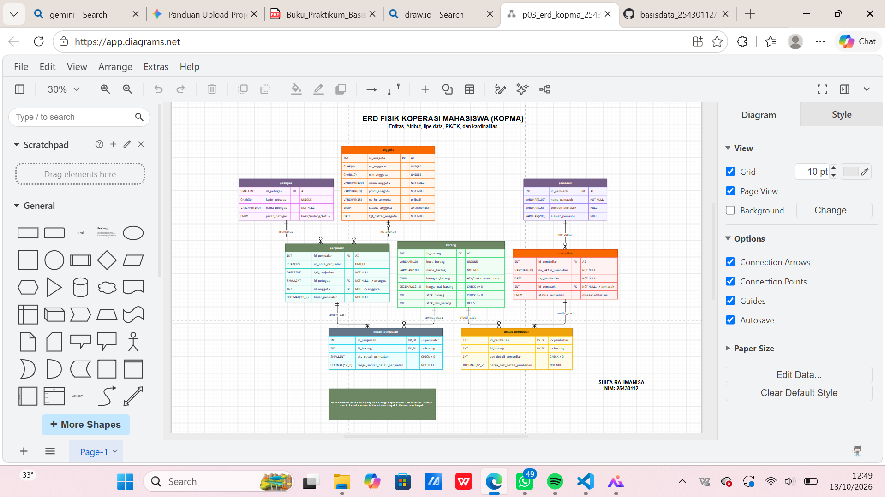
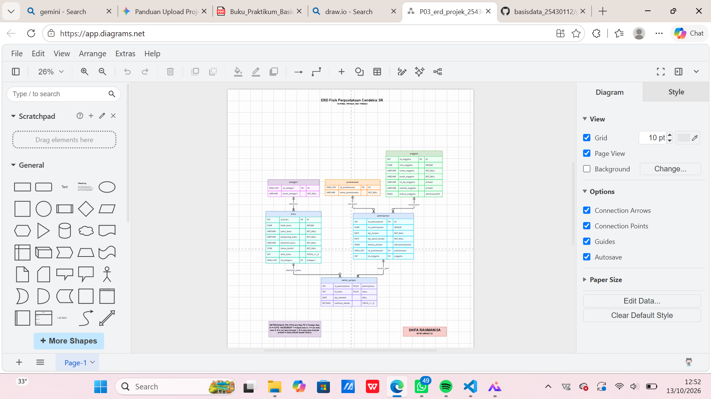

# Laporan Praktikum Basis Data - Pertemuan 03
**Nama:** Shifa Rahmanisa  **NIM:** 25430112  **Kelas:** D  **Tanggal:** [Tanggal Praktikum]

## 1. Tujuan Praktikum
* Memahami konsep perancangan basis data konseptual menggunakan Entity-Relationship Diagram (ERD).
* Mampu membuat dan menyusun ERD dengan kardinalitas relasi yang jelas dan terbaca menggunakan aplikasi draw.io.
* Mampu memetakan setiap entitas ke Primary Key (PK) dan Foreign Key (FK) berdasarkan hasil perancangan dari pertemuan sebelumnya.
* Mampu menganalisis dan mendefinisikan alasan penentuan kardinalitas pada relasi utama suatu sistem basis data.
## 2. Ringkasan Dasar Teori
Perancangan basis data konseptual merupakan tahapan krusial dalam siklus pengembangan sistem untuk merepresentasikan struktur data secara visual dan logis sebelum diimplementasikan ke dalam *Database Management System* (DBMS)
## 3. Hasil Langkah Percobaan
* **Identitas & Atribut Dasar:** Diagram ini dirancang oleh Shifa Rahmanisa (NIM: 25430112) untuk sistem basis data KOPMA, yang mendefinisikan Primary Key (PK), Foreign Key (FK), dan Auto Increment (AI) pada setiap tabel.
* **Entitas Utama:** Terdiri dari empat entitas utama yaitu anggota (data diri anggota), petugas (data kasir/pengurus), pemasok (data supplier), dan barang (stok inventaris).
* **Entitas Transaksi & Relasi:**
  * Transaksi penjualan dicatat oleh petugas dan dilakukan oleh anggota, serta dihubungkan ke barang melalui tabel asosiasi detail_penjualan[cite: 5].
  * Transaksi pembelian disuplai oleh pemasok dan dihubungkan ke barang melalui tabel asosiasi detail_pembelian.
  
## 4. Jawaban Titik Analisis
* **Pemetaan setiap entitas ke PB/KI dari Pertemuan 2:**
  * **Entitas Anggota:** Menggunakan `id_anggota` sebagai *Primary Key* (PB/PK) dan tidak memiliki *Foreign Key* (KI/FK) karena merupakan entitas independen.
  * **Entitas Petugas:** Menggunakan `id_petugas` sebagai *Primary Key* (PB).
  * **Entitas Pemasok:** Menggunakan `id_pemasok` sebagai *Primary Key* (PB).
  * **Entitas Barang:** Menggunakan `id_barang` sebagai *Primary Key* (PB).
  * **Entitas Penjualan:** Menggunakan `id_penjualan` sebagai *Primary Key* (PB), serta menyertakan `id_petugas` dan `id_anggota` sebagai *Foreign Key* (KI) untuk merujuk ke tabel petugas dan anggota.
  * **Entitas Pembelian:** Menggunakan `id_pembelian` sebagai *Primary Key* (PB), serta menyertakan `id_pemasok` sebagai *Foreign Key* (KI) untuk merujuk ke tabel pemasok.
  * **Tabel Asosiasi (`detail_penjualan` & `detail_pembelian`):** Menggunakan *Composite Primary Key* yang berasal dari gabungan ID transaksi dan ID barang, di mana kedua kolom tersebut bertindak sebagai *Foreign Key* (KI).

* **Penjelasan alasan kardinalitas relasi utama:**
  * **Petugas ke Penjualan (1:N):** Seorang petugas dapat mencatat banyak transaksi penjualan, tetapi setiap satu transaksi penjualan hanya dicatat oleh satu petugas tertentu.
  * **Anggota ke Penjualan (1:N):** Seorang anggota dapat melakukan banyak transaksi pembelian/penjualan di koperasi, namun satu transaksi penjualan spesifik hanya dilakukan oleh satu anggota.
  * **Pemasok ke Pembelian (1:N):** Seorang pemasok dapat menyuplai barang melalui beberapa kali transaksi pembelian, tetapi setiap transaksi pembelian bersumber dari satu pemasok yang sama.
  * **Penjualan/Pembelian ke Barang (M:N via Tabel Detail):** Hubungan *Many-to-Many* antara transaksi dan barang dipecah menggunakan tabel penghubung (`detail_penjualan` dan `detail_pembelian`) karena satu transaksi dapat memuat banyak jenis barang, dan sebaliknya satu jenis barang dapat dibeli atau dijual berulang kali dalam berbagai transaksi.

## 5. Hasil Latihan dan Modifikasi
* 
**Penyempurnaan Struktur Tabel dan Tipe Data:** Melakukan modifikasi pada penentuan tipe data seperti penggunaan `CHAR`, `VARCHAR`, `INT`, `SMALLINT`, `DECIMAL`, `ENUM`, dan `DATETIME` yang disesuaikan dengan kebutuhan setiap atribut pada entitas koperasi.
* **Implementasi Atribut Khusus dan Kunci (*Key*):** Menambahkan pengaturan *Primary Key* (PK), *Foreign Key* (FK), *Auto Increment* (AI), serta atribut unik (*UNIQUE*) untuk menjaga konsistensi identitas pada tabel anggota, petugas, pemasok, dan barang.
* **Penambahan *Constraints* (Batasan Nilai):** Menerapkan aturan khusus seperti batasan `CHECK >= 0` pada kolom harga dan stok barang, serta nilai *Default* (`DEF 5`) pada stok minimum barang untuk mengantisipasi kesalahan input data.

**Identitas & Informasi Umum:** Diagram ini dirancang oleh Shifa Rahmanisa (NIM: 25430112) dengan judul sistem *ERD Fisik Perpustakaan Cendekia SR*, yang mendefinisikan atribut, tipe data, *Primary Key* (PK), *Foreign Key* (FK), serta kardinalitas.
* **Entitas Utama Perpustakaan:**
  * **`anggota`**: Berisi data peminjam seperti `id_anggota` (PK), `nim_anggota`, nama, prodi, nomor HP, alamat, dan status anggota.
  * **`pustakawan`**: Berisi data pegawai perpustakaan dengan atribut `id_pustakawan` (PK), kode pustakawan, dan nama pustakawan.
  * **`kategori`**: Mengelompokkan buku berdasarkan jenisnya melalui `id_kategori` (PK) dan nama kategori.
  * **`buku`**: Menyimpan data inventaris buku dengan atribut `id_buku` (PK), kode buku, judul, pengarang, penerbit, tahun terbit, stok buku, serta `id_kategori` sebagai *Foreign Key*.
* **Entitas Transaksi & Relasi:**
  * **`peminjaman`**: Mencatat transaksi peminjaman utama yang dilakukan oleh **anggota** dan dilayani oleh **pustakawan** (`id_pustakawan` dan `id_anggota` bertindak sebagai *Foreign Key*).
  * **`detail_pinjam`**: Berfungsi sebagai tabel penghubung (*junction table*) untuk memecah relasi *Many-to-Many* antara tabel `peminjaman` dan `buku`, yang dilengkapi dengan atribut tanggal kembali dan nominal denda (dengan batasan `CHECK >= 0`)

## 6. Tugas Mandiri
* 
* 

## 7. Pembahasan dan Kendala
*Pembahasan
Pada praktikum ini, dilakukan perancangan *Entity-Relationship Diagram* (ERD) fisik untuk sistem "Perpustakaan Cendekia SR". Proses perancangan dimulai dengan menentukan entitas-entitas utama (seperti `anggota`, `pustakawan`, `kategori`, dan `buku`), menentukan atribut beserta tipe data yang sesuai, serta menetapkan *Primary Key* (PK) dan *Foreign Key* (FK) untuk menjaga integritas relasi antar tabel. Selain itu, relasi *Many-to-Many* antara tabel `peminjaman` dan `buku` berhasil diatasi dengan menggunakan tabel perantara (*junction table*) yaitu `detail_pinjam`.

### Kendala dan Solusi
* **Kendala 1:** Sempat mengalami kebingungan dalam menentukan arah garis relasi dan jenis kardinalitas (seperti *One-to-Many* dan *Many-to-Many*) agar sesuai dengan aturan normalisasi basis data.
  * **Solusi:** Melakukan pengecekan kembali pada modul praktikum dan mendiskusikannya dengan alur logika transaksi nyata (misalnya: satu peminjaman dapat mencakup banyak buku, dan satu buku dapat dipinjam dalam banyak transaksi).
* **Kendala 2:** Penyesuaian nama *Foreign Key* agar tidak keliru merujuk ke tabel induk di *draw.io*.
  * **Solusi:** Memastikan penamaan kolom konsisten, seperti menggunakan `id_kategori` pada tabel `buku` dan `id_pustakawan` serta `id_anggota` pada tabel `peminjaman`, lalu mengatur ulang tata letak garis penghubung agar diagram terlihat lebih rapi dan mudah dibaca.
## 8. Kesimpulan
*Perancangan model konseptual dan fisik basis data menggunakan *Entity-Relationship Diagram* (ERD) berhasil dilakukan dengan baik menggunakan aplikasi *draw.io*, menghasilkan struktur basis data yang terstruktur untuk sistem "Perpustakaan Cendekia SR".
* Penentuan atribut, tipe data, serta penetapan *Primary Key* (PK) dan *Foreign Key* (FK) pada setiap entitas (seperti `anggota`, `pustakawan`, `kategori`, `buku`, `peminjaman`, dan `detail_pinjam`) telah disesuaikan dengan aturan integritas data.
* Penerapan tabel penghubung (*junction table*) pada relasi *Many-to-Many* terbukti efektif dalam memecah hubungan kompleks antara transaksi peminjaman dan data inventaris buku.

## 9. Pernyataan Penggunaan AI
Saya menyatakan dengan sesungguhnya bahwa dalam penyusunan laporan praktikum dan perancangan struktur basis data ini, saya memanfaatkan kecerdasan buatan (*Artificial Intelligence*) sebagai sarana pendukung konsultasi, perumusan kerangka penulisan, serta penyusunan kalimat penjelas. Seluruh hasil akhir diagram (*draw.io*), pemahaman logika basis data, dan proses implementasi tetap melalui proses verifikasi dan penyesuaian mandiri sesuai dengan ketentuan modul praktikum.

## Checklist
*(salin dari buku, centang)*[cite: 2]
- [ ] Berkas wajib: `p03_erd_kopma_25430112` dan `p03_erd_25430112` (gambar + berkas sumber diagram)[cite: 1]
- [ ] Bukti tangkapan layar: ERD di *draw.io* dengan kardinalitas terbaca; catatan tinjauan klien[cite: 1]
- [ ] Analisis wajib: Pemetaan setiap entitas ke PB/KI dari Pertemuan 2; alasan kardinalitas relasi utama[cite: 1]
```[cite: 1, 2]