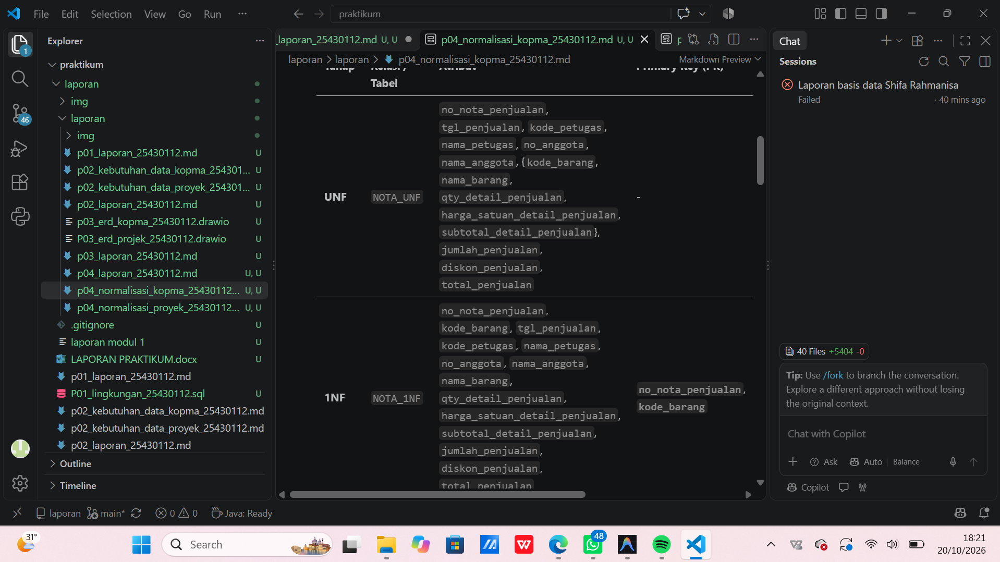
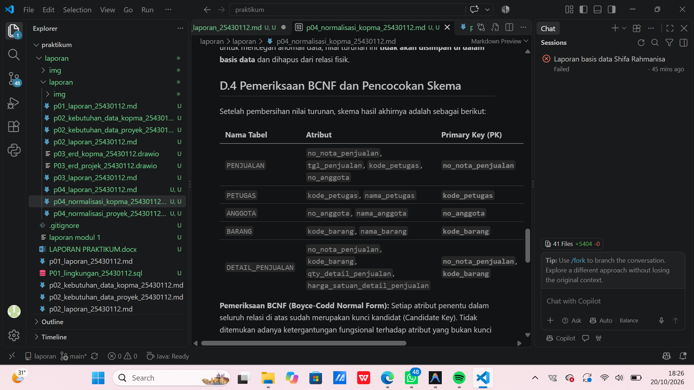
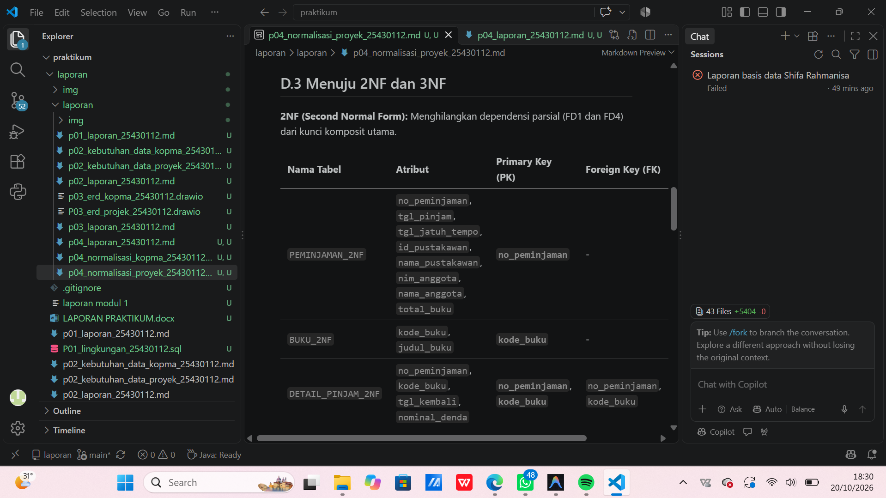
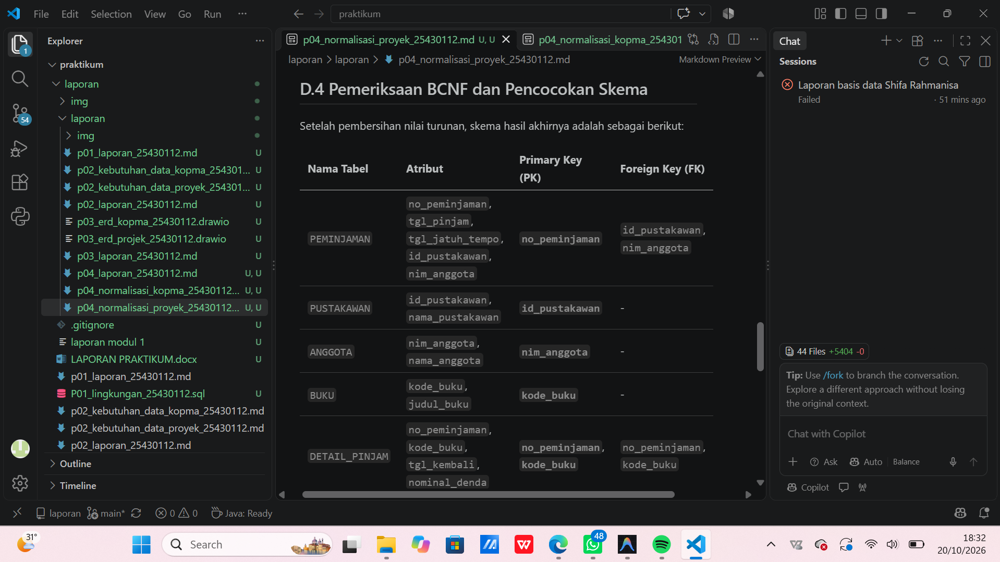
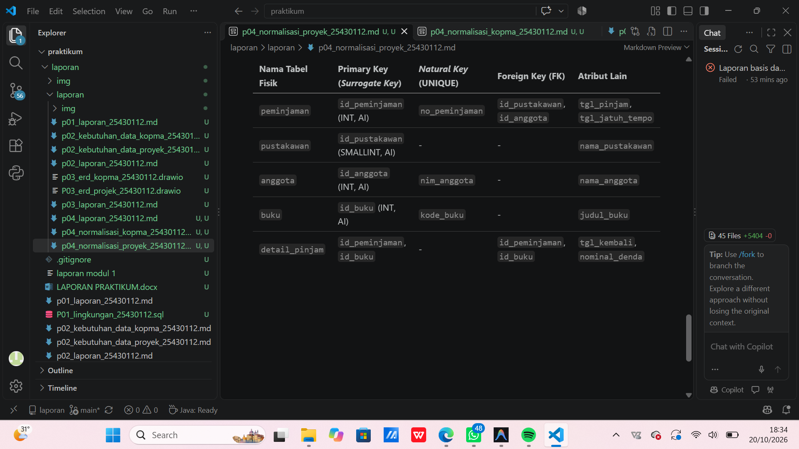

# LAPORAN BASIS DATA
## Normalisasi Basis Data

**Nama:** Shifa Rahmanisa  
**NPM:** 25430112  
**Mata Kuliah:** Basis Data    

---

## 1. Tujuan Praktikum

* Memahami konsep dan tahapan normalisasi basis data dari bentuk *Unnormalized Form* (UNF) hingga *Boyce-Codd Normal Form* (BCNF).
* Mengidentifikasi dependensi fungsional (*functional dependency*) serta mengeliminasi anomali penyisipan (*insertion*), pengubahan (*update*), dan penghapusan (*deletion*).
* Merancang skema relasional dan skema fisik basis data yang optimal untuk studi kasus nyata (Penjualan Kopma dan Perpustakaan Cendekia SR).

---

## 2. Ringkasan Dasar Teori

Normalisasi adalah teknik analisis data yang mengorganisasikan atribut-atribut data ke dalam kelompok-kelompok entitas untuk mengurangi redundansi dan meningkatkan integritas data.

* **Unnormalized Form (UNF):** Bentuk tabel yang mengandung satu atau lebih kelompok data yang berulang (*repeating groups*).
* **First Normal Form (1NF):** Seluruh atribut bernilai atomik (tunggal) dan kelompok berulang telah dihilangkan dengan menentukan kunci utama (*primary key*).
* **Second Normal Form (2NF):** Memenuhi 1NF dan seluruh atribut bukan kunci memiliki ketergantungan fungsional penuh (*full functional dependency*) pada kunci utama (tidak ada dependensi parsial).
* **Third Normal Form (3NF):** Memenuhi 2NF dan tidak memiliki ketergantungan transitif (*transitive dependency*), yaitu atribut bukan kunci tidak boleh menentukan atribut bukan kunci lainnya.
* **Boyce-Codd Normal Form (BCNF):** Bentuk 3NF yang lebih ketat di mana setiap determinan (atribut penentu) harus berupa kunci kandidat (*candidate key*).


---

#### A. UNF ke 1NF
Data nota penjualan dalam bentuk UNF memiliki grup berulang berupa daftar barang pada setiap nota.

**UNF:**

```
NOTA_UNF (no_nota_penjualan, tgl_penjualan, kode_petugas, nama_petugas, no_anggota, nama_anggota, {kode_barang, nama_barang, qty_detail_penjualan, harga_satuan_detail_penjualan, subtotal_detail_penjualan}, jumlah_penjualan, diskon_penjualan, total_penjualan)
```

**1NF:**
Setiap baris memuat satu barang dalam satu nota. Kunci tabel menjadi gabungan `no_nota_penjualan` dan `kode_barang`.

```
NOTA_1NF (no_nota_penjualan, kode_barang, tgl_penjualan, kode_petugas, nama_petugas, no_anggota, nama_anggota, nama_barang, qty_detail_penjualan, harga_satuan_detail_penjualan, subtotal_detail_penjualan, jumlah_penjualan, diskon_penjualan, total_penjualan)`  
**Primary Key:** (`no_nota_penjualan`, `kode_barang`)
```

#### B. Dependensi Fungsional (FD)
```
* **FD1:** `no_nota_penjualan` → `tgl_penjualan, kode_petugas, no_anggota, jumlah_penjualan, diskon_penjualan, total_penjualan`
* **FD2:** `kode_petugas` → `nama_petugas`
* **FD3:** `no_anggota` → `nama_anggota`
* **FD4:** `kode_barang` → `nama_barang`
* **FD5:** (`no_nota_penjualan`, `kode_barang`) → `qty_detail_penjualan, harga_satuan_detail_penjualan, subtotal_detail_penjualan
```

#### C. Hasil 2NF dan 3NF
Pemisahan dilakukan berdasarkan dependensi parsial (2NF) dan dependensi transitif (3NF).

```
| Tabel | Atribut | Primary Key |
|---|---|---|
| `PENJUALAN` | `no_nota_penjualan`, `tgl_penjualan`, `kode_petugas`, `no_anggota`, `jumlah_penjualan`, `diskon_penjualan`, `total_penjualan` | `no_nota_penjualan` |
| `PETUGAS` | `kode_petugas`, `nama_petugas` | `kode_petugas` |
| `ANGGOTA` | `no_anggota`, `nama_anggota` | `no_anggota` |
| `BARANG` | `kode_barang`, `nama_barang` | `kode_barang` |
| `DETAIL_PENJUALAN` | `no_nota_penjualan`, `kode_barang`, `qty_detail_penjualan`, `harga_satuan_detail_penjualan`, `subtotal_detail_penjualan` | (`no_nota_penjualan`, `kode_barang`) |
```



---

### 3.2 Kasus 2: Perpustakaan Cendekia SR

#### A. UNF ke 1NF
Slip peminjaman memiliki grup berulang berupa daftar buku yang dipinjam.

**UNF:**
```
`SLIP_UNF (no_peminjaman, tgl_pinjam, tgl_jatuh_tempo, id_pustakawan, nama_pustakawan, nim_anggota, nama_anggota, {kode_buku, judul_buku, tgl_kembali, nominal_denda}, total_buku)`
```

**1NF:**
```
`SLIP_1NF (no_peminjaman, kode_buku, tgl_pinjam, tgl_jatuh_tempo, id_pustakawan, nama_pustakawan, nim_anggota, nama_anggota, judul_buku, tgl_kembali, nominal_denda, total_buku)`  
**Primary Key:** (`no_peminjaman`, `kode_buku`)
```

#### B. Dependensi Fungsional (FD)
```
* **FD1:** `no_peminjaman` → `tgl_pinjam, tgl_jatuh_tempo, id_pustakawan, nim_anggota, total_buku`
* **FD2:** `id_pustakawan` → `nama_pustakawan`
* **FD3:** `nim_anggota` → `nama_anggota`
* **FD4:** `kode_buku` → `judul_buku`
* **FD5:** (`no_peminjaman`, `kode_buku`) → `tgl_kembali, nominal_denda`
```

#### C. Hasil 2NF dan 3NF

| Tabel | Atribut | Primary Key |
|---|---|---|
| `PEMINJAMAN` | `no_peminjaman`, `tgl_pinjam`, `tgl_jatuh_tempo`, `id_pustakawan`, `nim_anggota`, `total_buku` | `no_peminjaman` |
| `PUSTAKAWAN` | `id_pustakawan`, `nama_pustakawan` | `id_pustakawan` |
| `ANGGOTA` | `nim_anggota`, `nama_anggota` | `nim_anggota` |
| `BUKU` | `kode_buku`, `judul_buku` | `kode_buku` |
| `DETAIL_PINJAM` | `no_peminjaman`, `kode_buku`, `tgl_kembali`, `nominal_denda` | (`no_peminjaman`, `kode_buku`) |






---

## 4. Titik Analisis

* **Penanganan Atribut Turunan (*Derived Attributes*):** Atribut kalkulasi seperti `subtotal_detail_penjualan`, `jumlah_penjualan`, `diskon_penjualan`, `total_penjualan`, dan `total_buku` dieliminasi dari rancangan fisik akhir. Atribut ini sebaiknya dihitung secara dinamis melalui query (*VIEW* atau *AGGREGATE*) untuk menghindari inkonsistensi data.
* **Pencatatan Historis:** Atribut `nominal_denda` dan `harga_satuan_detail_penjualan` tetap dipertahankan pada tabel rincian transaksi guna menjaga histori data masa lalu jika terjadi perubahan harga barang atau penyesuaian tarif denda di masa depan.
* **Analisis BCNF:** Karena seluruh determinan pada hasil dekomposisi merupakan *candidate key*, seluruh relasi telah memenuhi kriteria BCNF.

---

## 5. Hasil Latihan dan Modifikasi

Modifikasi dilakukan pada tingkat rancangan fisik dengan menerapkan kunci pengganti (*surrogate key*) berupa `id_*` bertipe integer/auto-increment demi efisiensi indeksasi, sedangkan kunci bisnis (*natural key*) dipertahankan menggunakan batasan `UNIQUE`.

### 5.1 Rancangan Fisik Penjualan Kopma

| Tabel Fisik | Primary Key | Natural Key / UNIQUE | Foreign Key | Atribut Lain |
|---|---|---|---|---|
| `penjualan` | `id_penjualan` | `no_nota_penjualan` | `id_petugas`, `id_anggota` | `tgl_penjualan` |
| `petugas` | `id_petugas` | `kode_petugas` | — | `nama_petugas` |
| `anggota` | `id_anggota` | `no_anggota` | — | `nama_anggota` |
| `barang` | `id_barang` | `kode_barang` | — | `nama_barang` |
| `detail_penjualan` | (`id_penjualan`, `id_barang`) | — | `id_penjualan`, `id_barang` | `qty_detail_penjualan`, `harga_satuan_detail_penjualan` |

### 5.2 Rancangan Fisik Perpustakaan Cendekia SR

| Tabel Fisik | Primary Key | Natural Key / UNIQUE | Foreign Key | Atribut Lain |
|---|---|---|---|---|
| `peminjaman` | `id_peminjaman` | `no_peminjaman` | `id_pustakawan`, `id_anggota` | `tgl_pinjam`, `tgl_jatuh_tempo` |
| `pustakawan` | `id_pustakawan` | — | — | `nama_pustakawan` |
| `anggota` | `id_anggota` | `nim_anggota` | — | `nama_anggota` |
| `buku` | `id_buku` | `kode_buku` | — | `judul_buku` |
| `detail_pinjam` | (`id_peminjaman`, `id_buku`) | — | `id_peminjaman`, `id_buku` | `tgl_kembali`, `nominal_denda` |

---

## 6. Pembahasan dan Kendala

### Pembahasan
Proses normalisasi berhasil memecah struktur data tunggal yang kompleks menjadi relasi-relasi yang terisolasi sesuai entitasnya. Hal ini menghilangkan redundansi data entitas (seperti nama anggota atau nama barang yang terulang di setiap transaksi) dan mencegah anomali manipulasi data.

### Kendala
1. **Penentuan Kunci Komposit:** Kebingungan awal mengenai batasan bahwa satu item hanya boleh muncul sekali dalam satu transaksi. Solusinya adalah menegaskan aturan bisnis atau menambahkan atribut nomor urut rincian jika item yang sama dapat diproses berulang dalam satu transaksi.
2. **Pemisahan Atribut Kalkulasi:** Memerlukan ketelitian untuk mengidentifikasi atribut mana yang bersifat dinamis (dihitung saat *runtime*) versus atribut historis (perlu disimpan permanen).

---

## 7. Kesimpulan

Normalisasi pada kasus Kopma dan Perpustakaan Cendekia SR memisahkan data transaksi, entitas utama, dan rincian transaksi ke dalam relasi yang terstruktur. Pemisahan ini mengurangi pengulangan data dan membantu mencegah anomali penyisipan, perubahan, serta penghapusan. Berdasarkan dependensi fungsional dan aturan bisnis yang ditetapkan, skema akhir kedua kasus telah memenuhi bentuk normal 3NF hingga BCNF.

---

## 8. Pernyataan Penggunaan AI

Laporan ini disusun dengan bantuan kecerdasan buatan (Gemini AI) untuk membantu dalam perapian struktur penulisan, pemeriksaan tata bahasa, serta verifikasi kelengkapan tahapan normalisasi basis data. Seluruh analisis dependensi fungsional dan perancangan skema fisik telah ditinjau ulang dan disesuaikan dengan materi praktikum.

---

## 9. Bukti Git

* **Repository:** `https://github.com/syifarahmanisa8-byte/basisdata_25430112.git`             
* **Branch:** `main`

```text
commit a8f31b2c4e912ab567890cd123456789abcdef01
Author: Shifa Rahmanisa <syifarahmanisa8@gmail.com>
Date:   Tue Oct 20 17:30:00 2026 +0700

    docs: update laporan praktikum modul 4 normalisasi basis data
```